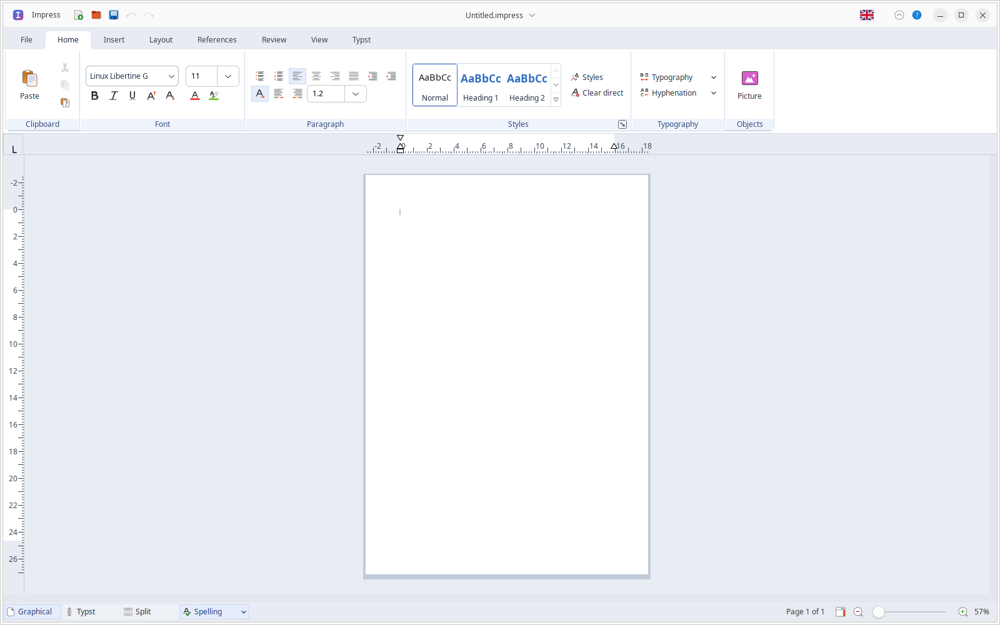

# Impress

Impress is a desktop word processor for writing, formatting and printing documents. It combines a ribbon interface and paginated editing with an integrated Typst equation editor.

## What you can do

- **Write and format visually.** Work with paragraph and character styles, headings, lists, page margins, columns, headers and footers.
- **Build structured documents.** Insert pictures, edit tables directly on the page, and add equations through the integrated editor.
- **Control typography.** Choose font families, adjust kerning and ligatures, check spelling in multiple languages, and optionally embed fonts when saving `.impress` or DOCX files.
- **Exchange files.** Open and save native `.impress`, DOCX, Word 97–2003 DOC, RTF and structured Typst documents. Import PDFs as editable content, export PDFs, and print.
- **Keep working comfortably.** Open multiple documents in one window, return through Recent Files, and recover unsaved work.

Format support depends on the features used in a document. The [DOCX](docs/DOCX-COMPATIBILITY.md) and [DOC](docs/DOC-COMPATIBILITY.md) guides describe the supported structures and current limits.

## Get started

Choose the release matching your Linux distribution (64-bit x86 / amd64):

| System | Download |
| --- | --- |
| Linux Mint 22.x | [Mint packages](https://github.com/NullMagic2/Impress/releases/tag/v0.8.6-59-mint22) |
| Ubuntu 24.04 / 26.04 LTS | [Ubuntu packages](https://github.com/NullMagic2/Impress/releases/tag/v0.8.6-59-ubuntu) |
| Debian 13 | [Debian packages](https://github.com/NullMagic2/Impress/releases/tag/v0.8.6-59-debian13) |

The packages include the desktop editor and command-line converter. See [Linux packages](docs/LINUX-PACKAGES.md) for installation and validation details. Windows build scripts are included in the source; see the [build guide](docs/BUILDING.md).

Open Impress to start with an empty document, or use **File → Open** to work on an existing file. Save in `.impress` to keep the native document, or choose another supported format with **Save as**.

## Learn more

- [Links and the clipboard](docs/LINKS-AND-CLIPBOARD.md)
- [Equations](docs/EQUATIONS.md) and [typography](docs/TYPOGRAPHY.md)
- [Styles](docs/STYLE-UPDATE.md) and [spellchecking](docs/SPELLCHECKING.md)
- [Page rulers](docs/PAGE-RULERS.md), [tab stops](docs/TAB-STOPS.md), and [recent files and table snapping](docs/RECENT-FILES-AND-TABLE-SNAP.md)
- [Building from source](docs/BUILDING.md), [architecture](ARCHITECTURE.md), and [contribution style](STYLE_GUIDE.md)
- [Project history](HISTORY.md)

## License and credits

Impress is distributed under the [MIT License](LICENSE). The interface uses [Yaru artwork](crates/gui/assets/ribbon/YARU_ICONS.md), and bundled third-party components and test fonts retain their own licenses.
